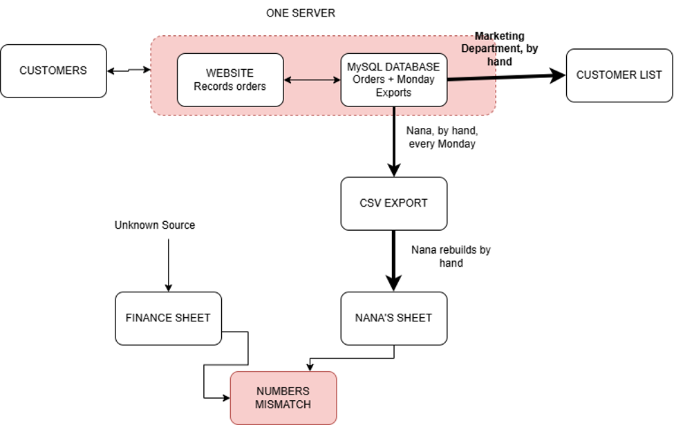

# Kloud Kart Data Strategy Engagement

## Situation Diagnosis

**How I ranked these findings:** by risk to the board conversation, using three tests in order. First, is the worst case capped? Second, can it be fixed after the fact? Third, will the regulator or the investors ask about it? Ties are broken by expected yearly cost, then by how fast the problem grows with Kloud Kart, including Nigeria. Finding 1 fails all three tests. Findings 2 to 5 pass them, so they are ranked on expected cost alone, which is a weaker basis, and I say so openly.

## Kloud Kart Today

## How Data Moves

## Key Findings

### 1. Customer data is uncontrolled and not fully deletable

Marketing exports the customer list with no tracking of how many copies exist. The list holds about 300,000 people, and every export creates copies that nobody records.

**Root cause:** customer data has no owner and no rules. There is no named person responsible, no rules on who may export or where export copies go, no log of exports, and no deletion process that covers the copies.

**Compliance:** Kloud Kart has an open Data Protection Commission complaint about a deleted customer’s data, and 90 days to respond. Without a record of where the copies are, Kloud Kart can’t show that a deleted customer is gone. As I understand Ghana’s Data Protection Act, 2012 (Act 843), this is a gap, and it grows when the Nigeria pilot adds customers.

**Where one customer’s data lives today (as I understand it):** the live MySQL database; the CSV files exported on Mondays; Nana’s spreadsheet; Finance’s spreadsheet, if it holds customer details; an unknown number of exported customer lists held by Marketing; and any backups, whose state I couldn’t verify.

**Principles of Act 843 at risk (as I understand them):** Section 17 of the Act lists eight principles. Two are directly at risk:

- **Accountability:** with no owner and no record, Kloud Kart can’t show that it is complying.
- **Data subject participation:** a customer’s deletion request can’t be fully honoured while the copies are unknown.

**Data security safeguards** is a close third, because uncontrolled copies are exposed. I am not a lawyer, and this is my reading, not legal advice.

**Registration:** the brief doesn’t say whether Kloud Kart is registered with the Data Protection Commission. I assume it is not, until Nana confirms. As I understand it, organisations that collect or process personal data in Ghana must register, and a shop holding 300,000 customers’ details is one of them. Assuming it is unregistered is the safer choice: checking costs almost nothing, and being wrong would be a finding of its own.

**Cost (assumed):** risk-weighted exposure, as a range.

- **Chance of an upheld complaint or incident in 12 months:** 20–50%. The drivers are 300,000 contacts, an unknown number of copies, the Nigeria pilot and the open complaint.
- **Impact if it happens:**
  - Staff time to trace copies by hand: 100 hours × GHS 60 = GHS 6,000.
  - Legal advice: GHS 30,000–100,000.
  - Penalty: GHS 50,000–300,000. This is a stand-in, because I haven’t verified Act 843’s penalties.
  - Impact total: GHS 86,000–406,000.
- **Exposure:** 20% × GHS 86,000 to 50% × GHS 406,000 ≈ GHS 17,000–200,000 a year.
- **Not priced:** investor trust, and customers leaving.

**Stress test:** even if I’m wrong about the chance by half (10–25%), exposure is still about GHS 9,000–100,000, and the real downside, in public with the regulator and investors, isn’t capped.

**Why it ranks first:** it is the only finding that fails all three tests. Its worst case isn’t capped, a complaint missed at day 90 can’t be fixed afterwards, and both the regulator and the investors will ask about it.

### 2. Reporting and the live website share one box

**Root cause:** orders, inventory and customer accounts sit in one MySQL database on the same box as the live website. A Monday export competes with customers for the same machine.

**Cost (assumed):** about 340 orders an hour on Monday morning, an average order of GHS 300, and a one-hour slowdown that halves orders. Of the 170 orders affected, 30–60% are lost for good; the rest come back later. That is about GHS 15,000–31,000 per incident, so about GHS 31,000–61,000 last month. If it keeps happening twice a month, that is about GHS 360,000–740,000 a year.

**Stress test:** even if I’m wrong about the Monday-morning order rate by half (170 an hour), each incident still costs about GHS 8,000–15,000, and it happened twice in one month.

**Why it ranks second:** it passes the three tests, because the damage stops as soon as reporting moves off the box. But at my assumptions it has the highest expected yearly cost of findings 2 to 5, and the fix is already approved.

### 3. Nana and Finance calculate the same numbers differently

**Root cause:** Nana rebuilds her Monday numbers by hand from CSV exports, and Finance’s spreadsheet never matches hers. They disagree because there is no single agreed definition for each number, and each report is rebuilt by hand. For example, revenue could mean ordered, paid, shipped or delivered.

**Quality dimension:** consistency. The same number doesn’t agree across two places.

**Cost (assumed):**

- **Time:** about 6 hours a week for Nana’s rebuild and 4 hours a week for Finance’s reconciling. That is about 520 hours a year × GHS 60 = about GHS 31,000.
- **Wrong decisions:** the board decides on two versions of the same numbers, which I estimate costs GHS 80,000–320,000 a year.
- **Total:** about GHS 111,000–351,000 a year.

**Stress test:** even if I’m wrong about the wrong-decision cost by half, finding 3 still costs about GHS 71,000–191,000 a year.

**Why it ranks third:** it passes the three tests and has the second-highest expected yearly cost. It also recurs every week.

### 4. The board was handed words before a need

**Root cause:** the wish list was assembled from investor and developer comments, not through a requirements process. Investors asked about data strategy and real-time analytics, but no one has said which decision needs faster data.

**Cost (assumed):** risk-weighted exposure.

- Assume a 50% chance that a real-time build goes ahead.
- If it does, running costs are about GHS 6,000–18,000 a month, which is GHS 72,000–216,000 a year.
- A new hire’s time is diverted for 3 months at GHS 15,000 a month, which is GHS 45,000.
- If built: GHS 117,000–261,000. Exposure at 50%: GHS 59,000–131,000 a year.

**Stress test:** even if I’m wrong about the chance by half (25%), exposure is still about GHS 29,000–65,000, and the first-year hire is pointed at the wrong job.

**Risk:** money gets spent on a real-time dashboard because a board member saw one at another portfolio company, not because Kloud Kart needs it.

**Why it ranks fourth:** it costs less than finding 3 (GHS 59,000–131,000 against GHS 111,000–351,000), and it is a one-time decision that this recommendation already settles. Finding 3 recurs every week.

### 5. One developer is the only person who understands the data

**Root cause:** Kloud Kart has one developer (PHP/MySQL), and nobody else has run a warehouse or written Python professionally.

**Cost (assumed):**

- **Leaving:** a 15–25% chance the developer leaves or is unavailable in a year. Cover costs about GHS 25,000 a month × 3 = GHS 75,000, plus a recruiter fee of about GHS 27,000 (15% of an assumed GHS 180,000 salary). That is about GHS 102,000.
- **Outage:** a 5–10% chance of one extra-long outage while nobody can fix the shop. One day of orders is 4,000 × GHS 300 = GHS 1.2 million, of which 30–60% is lost: GHS 360,000–720,000.
- **Exposure, treating the two risks as independent:** leaving, 15–25% × GHS 102,000 = GHS 15,000–26,000; outage, 5–10% × GHS 360,000–720,000 = GHS 18,000–72,000. Total: about GHS 33,000–98,000 a year.

**Stress test:** even if I’m wrong about both chances by half, exposure is still about GHS 16,000–49,000 a year. The reason to care is the tail: a single bad day can cost GHS 360,000 or more.

**Risk:** every fix waits on one person, and if they leave, the knowledge leaves too. Two hires reduce this risk but don’t remove it.

**Why it ranks fifth:** it is slower-burning, and its expected yearly cost is the lowest of the five, though only just. Its worst case is large, so a challenger could argue it should rank higher. I chose expected cost as the tiebreak and apply it consistently.

## Assumptions

- About 4,000 orders a day; about 340 an hour on Monday morning. If wrong: slowdown costs scale up or down in proportion.
- Average order of GHS 300. If wrong: all revenue-based costs scale in proportion.
- Each slowdown lasts one hour and halves orders; 30–60% of those are lost for good. If wrong: finding 2’s cost changes in proportion; the fix stays the same.
- Slowdowns continue at twice a month if nothing changes. If wrong: finding 2’s yearly cost falls, but it would still rank above finding 3 at one a month.
- Nana’s Monday rebuild takes about 6 hours a week; Finance reconciles for about 4 hours a week; staff time costs GHS 60 an hour. If wrong: finding 3’s time cost changes; the definitions work stays the same.
- Wrong decisions made on two versions of the numbers cost GHS 80,000–320,000 a year. If wrong: finding 3’s total moves with it; the stress test shows it still costs at least GHS 71,000.
- The brief doesn’t say stock is live. I assume overselling comes from lag (the count shown is older than the real count) and mismatch (the system count differs from the shelf, through returns, damage or stock not booked in). If wrong: if the cause is two buyers taking the last unit at once, or a mismatch alone, moving reports off the box won’t fix it, and the stock fix in ADR-003 must change. This is my first question for the developer.
- Kloud Kart is not registered with the Data Protection Commission. If wrong: one compliance task drops out of Q1.
- Growth of 15–20% a year, as the brief states. If wrong: faster growth brings forward the month 10 review.
- Nigerian customers are in the same database and the same marketing list. If wrong: deletion must reach a second set of copies.
- Chance of an upheld complaint or incident in 12 months: 20–50%. If wrong: finding 1’s exposure scales, but it still ranks first because the downside isn’t capped.
- Staff time to trace copies by hand: 100 hours. If wrong: small effect on finding 1’s total.
- Legal advice GHS 30,000–100,000; penalty GHS 50,000–300,000 (stand-ins, not verified against Act 843). If wrong: finding 1’s exposure moves with them; verify before the board meeting.
- Chance a real-time build goes ahead: 50%; running costs GHS 6,000–18,000 a month. If wrong: finding 4’s exposure scales.
- A new hire costs GHS 15,000 a month (GHS 180,000 a year); 3 months diverted to real-time work. If wrong: the hiring cost and finding 4’s exposure change in proportion.
- Chance the developer leaves or is unavailable in a year: 15–25%; cover GHS 25,000 a month for 3 months; recruiter fee 15% of salary. If wrong: finding 5’s leaving cost changes.
- Chance of one extra-long outage in a year: 5–10%, independent of the developer leaving; 30–60% of that day’s orders lost. If wrong: finding 5’s outage cost changes; if the two risks are linked, the total is higher.
- The 90-day clock started when the board approved the plan. If wrong: if it started earlier, the month 3 deadline moves forward.
- Warehouse cost USD 100–300 a month; exchange rate GHS 11.50 to USD 1 (Bank of Ghana, 17 September 2026). If wrong: the total cost changes slightly; the plan stays the same.

## Questions I Would Ask, and What I Assumed Instead

### 1. Nana and Finance

**Question:** what does revenue mean to you: ordered, paid, shipped or delivered?

**Assumption:** each side uses a different definition.

**If wrong:** if they already agree, the mismatch comes from manual errors, and the definitions page shrinks to a check.

### 2. Finance

**Question:** how many hours a week do you spend reconciling your numbers with Nana’s?

**Assumption:** 4 hours a week.

**If wrong:** finding 3’s time cost changes.

### 3. Nana

**Question:** how many board decisions last year used these numbers, and roughly how big were they?

**Assumption:** wrong decisions cost GHS 80,000–320,000 a year.

**If wrong:** finding 3’s total changes, and so could its rank against finding 4.

### 4. Developer

**Question:** how does an oversell happen today: a stale count on screen, two buyers at once, or counts not matching the shelf? How many happened last quarter?

**Assumption:** lag plus mismatch.

**If wrong:** the stock fix in ADR-003 changes, and low-stock warnings may not be the right fix.

### 5. Developer

**Question:** who can export customer data, is it logged, and do backups bring a deleted customer back?

**Assumption:** anyone can export, nothing is logged, and the state of backups is unknown.

**If wrong:** the size of the register work changes, and deletion may need to reach backups too.

### 6. Nana

**Question:** is Kloud Kart registered with the Data Protection Commission, and is the deleted-customer complaint real or hypothetical?

**Assumption:** not registered; the complaint is real.

**If wrong:** the Q1 compliance tasks and the month 3 deadline change.

## Recommendation and Roadmap

**My position:** Kloud Kart doesn’t need real-time analytics or a big data platform. It needs reporting moved off the shop’s machine, one agreed definition for each number, and a record of where customer data lives. On top of that, it needs a small warehouse, refreshed overnight. That fits Kloud Kart’s size.

### What to build, in this order

1. A separate copy of the database for reporting, on the pre-approved second server. MySQL and the live website must stay up, so Monday numbers come from the copy and reporting never touches the live site.
2. One page of definitions. About ten numbers (orders, revenue, returns and so on), each defined once and signed off by Nana and Finance. This stops Finance’s figures and Nana’s from disagreeing.
3. A small cloud warehouse, refreshed overnight. The developer’s wish to “just buy Snowflake or BigQuery” is right on the destination and wrong on timing: definitions come first, then the purchase.
4. A customer-data register and one deletion list. Every place customer data lives is written down, including the warehouse. Anyone deleted goes on one list that every refresh and every marketing export must follow. This lets Kloud Kart answer the Commission within the 90 days, and I set a 30-day internal target for future requests.

### What I’m deliberately not building

1. A lake or lakehouse. Kloud Kart has tidy tables and a 40 GB database, not piles of messy files.
2. Real-time dashboards. Everything except stock can refresh daily. Nobody at Kloud Kart would act differently at 10:03 than the next morning.
3. Machine learning for demand forecasting. It waits until there is clean history to learn from. The month 10 review decides whether it’s worth doing.

### What stays as it is: stock

Stock counts can’t go stale. Stock stays live in the shop, where it is always current, and the overnight refresh doesn’t touch it. Overselling is fixed in the shop, not with a dashboard: the developer adds low-stock warnings by the end of month 8.

### What Nana can tell investors

- **“What’s our data strategy?”** First, stop reporting from slowing the shop, agree one version of every number, and know where every customer’s data lives. Then build on that.
- **“What about real-time analytics?”** Only stock needs to be live, and it already is. Everything else is updated every morning, because no decision changes within a day.
- **“What about AI and forecasting?”** Not yet. Forecasting needs a clean history first. We’ll decide in month 10, with evidence.

### Roughly what it costs

- **Reporting copy:** the server is already approved.
- **Warehouse:** about USD 100–300 a month, which is about GHS 1,150–3,450 a month, or GHS 14,000–41,000 a year (my estimate; not yet checked against the provider’s pricing).
- **Two hires:** the main cost. I assume about GHS 180,000 a year each, so about GHS 360,000 a year.
- **Total:** about GHS 374,000–401,000 a year, plus the running cost of the approved server.

**No third hires this year.** Two roles cover the plan, and forecasting waits.

## The Two Hires

### 1. Data engineer first

Because nothing reliable can be built while reports still run on the live box and nothing controls the customer lists. Their work is the base for everything else.

**First 90 days:** set up the reporting copy and the overnight refresh, build the deletion list into every refresh, and take the Monday report off Nana’s desk. Write down how it all works, so it isn’t only in one person’s head.

### 2. Analytics engineer second, from early Q2

**First 90 days:** turn the signed-off definitions into the actual numbers, own the board dashboard, and run a weekly check that Operations’ and Finance’s totals match, explaining any gap.

I assume the data engineer starts in month 1. Until the analytics engineer arrives, Nana and Finance agree the definitions page themselves.

## What the plan survives

- Orders double or triple. At 15–20% growth that takes years, and a rented warehouse grows without a redesign.
- Nigeria grows faster than expected. Reports are split by country from day one.
- The open complaint escalates. The first job is to answer “where is this customer?”, even before the register is finished. By the end of month 3, Kloud Kart can show the Commission the customer is gone from every copy.
- The budget is cut. The reporting copy and the definitions cost almost nothing, so they stay. The warehouse can wait a quarter.
- A hire falls through. The data engineer’s written notes mean the plan doesn’t live in one person’s head.

## What I Couldn’t Verify

Real cost figures, the number of copies of the customer list, the state of backups, the salaries, and how Nigerian data rules apply to the pilot.

## 12-Month Roadmap (by quarter)

Each quarter ends with outcomes Nana can check herself.

### Quarter 1: Safe and agreed

- By the end of month 1, Nana can run her Monday numbers without the shop slowing down, for four Mondays in a row.
- By the end of month 2, Operations and Finance have signed one page of ten agreed definitions.
- By the end of month 2, a written list shows every place customer data lives.
- By the end of month 3 (within 90 days of the complaint), Kloud Kart can show the Commission that the deleted customer is gone from every copy.

### Quarter 2: One set of numbers

- By the end of month 4, the Monday report is in Nana’s inbox by 7:00 a.m., with no CSV exports.
- By the end of month 5, Operations’ and Finance’s totals have matched for at least three weeks in a row, and any gap is explained in writing.
- By the end of month 6, a test customer is deleted and shown to be gone everywhere.

### Quarter 3: The board can see it

- By the end of month 7, a board dashboard updates every morning, with Nigeria shown separately.
- By the end of month 8, low-stock warnings appear in the shop.
- By the end of month 9, every customer-list export is logged with who received it and when.

### Quarter 4: Decide the second year with evidence

- By the end of month 10, a short written review answers three questions: do we need streaming, do we need forecasting, and what should year two look like? The board then decides what to fund in year two.
- By the end of month 12, a deletion request is answered within the 30-day internal target, and Nana can show the log to the board.
